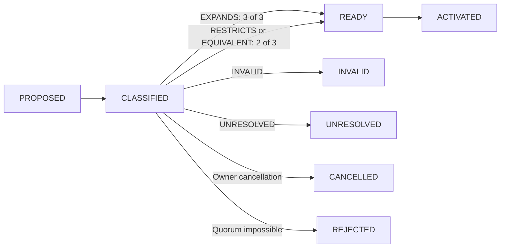
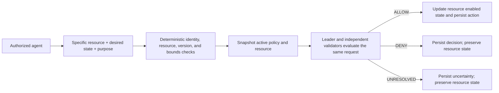

# SLATE

Versioned Policy Governance & Enforcement on GenLayer.

SLATE lets organizations change the policies that govern their authorized AI agents. GenLayer evaluates whether a proposed policy expands, restricts, or preserves the agent's authority. Deterministic reviewer thresholds then gate activation. Once an amendment is approved and activated, the new policy governs future protected-resource operations.

SLATE is an Intelligent Contract with consequential on-chain behavior: it manages registered resources whose `enabled` state can change only through an agent action authorized by the currently active policy. It does not merely store AI classifications.

## Overview

Each organization has an owner, one authorized agent, three fixed reviewers, immutable policy versions, amendments, protected resources, and action decisions. Multiple organizations share one deployed contract while their records remain bound to their own organization IDs.

The V1 protocol is intentionally bounded and deterministic around its semantic decisions:

- Four resources per organization.
- Eight amendments per organization.
- Twelve agent actions per organization.
- Nine policy versions per organization, including version 1.
- One pending amendment per organization.

## Problem addressed

Natural-language policies can evolve as an organization changes. A policy update should therefore have a visible governance path and should affect the rules used for future operations. SLATE connects semantic comparison, reviewer approval, immutable history, and an actual contract-managed state transition.

## Key features

- Semantic amendment classification: `EXPANDS`, `RESTRICTS`, `EQUIVALENT`, `INVALID`, or `UNRESOLVED`.
- Fixed three-reviewer governance with deterministic approval quorums.
- Immutable policy versions and version-bound action decisions.
- Protected resources that begin disabled and can be enabled or disabled only through the agent action path.
- Independent GenLayer leader and validator reasoning for both semantic operations.
- Strict JSON response schemas, bounded UTF-8 inputs, canonical digests, and cross-organization checks.
- No funds transfers, external contract calls, or arbitrary off-chain operations.

## How SLATE works

An owner creates an organization with its initial policy, agent, and three reviewers. The contract creates immutable policy version 1. The owner may register named resources, which start disabled.

An amendment is proposed against the current active version. GenLayer compares the active and proposed policies. After a classified result, the configured reviewers vote once each. A ready amendment can then be activated, creating the next immutable policy version. Future agent operations use only that active version.

### Policy amendment lifecycle

An owner can cancel only a `PROPOSED` or `CLASSIFIED` amendment. `READY`, activated, rejected, cancelled, invalid, and unresolved amendments cannot be reopened or cancelled.

### Semantic amendment classification

The comparison prompt supplies the active policy, proposed policy, rationale, organization context, authorized-agent scope, and immutable protocol boundaries. Policy text is treated as untrusted data and cannot change the hardcoded reviewer rules.

- `EXPANDS`: any meaningful authority increases; mixed expansion and restriction is still `EXPANDS`.
- `RESTRICTS`: authority is reduced without adding authority elsewhere.
- `EQUIVALENT`: wording changes without a material effective-permission change.
- `INVALID`: the proposal attempts to govern immutable protocol controls, such as ownership, reviewer authorization, thresholds, resource existence, or supported operations.
- `UNRESOLVED`: a reliable comparison cannot be established.

Malformed, duplicated-key, contradictory, or unexpected semantic JSON is rejected. Uncertainty never defaults to `EQUIVALENT`.

### Reviewer voting and thresholds

The reviewer set is fixed when the organization is created. Address distinctness does not prove independent real-world control; the owner and agent may overlap with reviewer roles when explicitly configured.

| Classification | Required approvals |
| --- | ---: |
| `EXPANDS` | 3 of 3 |
| `RESTRICTS` | 2 of 3 |
| `EQUIVALENT` | 2 of 3 |
| `INVALID` | Cannot activate |
| `UNRESOLVED` | Cannot activate |

Each reviewer can vote once per amendment. Approval counts and rejection counts are checked against the stored vote records. Activation is permissionless only after `READY` has been established with the required approvals.

### Active policy enforcement

Only the configured agent can request a supported state change for an existing resource. The contract checks organization identity, resource ownership, current state, desired state, active policy version, and input bounds before semantic execution. A no-op state request is rejected.

The semantic result is strictly one of `ALLOW`, `DENY`, or `UNRESOLVED`. `ALLOW` updates the actual resource state. `DENY` and `UNRESOLVED` persist a decision without changing the resource. The owner has no direct toggle method.

## Multi-organization reuse

One deployment serves independent organizations. Organization IDs, owner identities, agent identities, reviewers, resources, amendments, versions, votes, and actions are bound in canonical records and digests. Direct lookups validate the expected organization binding; there is no global history scan or cross-organization authorization fallback.

## Smart contract architecture

SLATE uses nine `TreeMap[str, str]` stores and three scalar counters. Canonical JSON records keep storage access bounded and make record integrity checkable without persistent dynamic arrays.

The stores are:

1. `organization_records`
2. `policy_version_records`
3. `resource_records`
4. `resource_key_index`
5. `amendment_records`
6. `amendment_vote_records`
7. `action_records`
8. `pending_amendment_by_org`
9. `latest_org_by_owner`

Persistent `DynRay` and `DynArray` usage is zero. There are no token transfers and no external contract calls.

## Public contract methods

### Writes

1. `create_organization(name, initial_policy, agent, reviewer_1, reviewer_2, reviewer_3) -> str`
2. `register_resource(organization_id, resource_key, description) -> str`
3. `propose_amendment(organization_id, proposed_policy, rationale) -> str`
4. `classify_amendment(amendment_id) -> str`
5. `vote_amendment(amendment_id, approve) -> None`
6. `activate_amendment(amendment_id) -> str`
7. `cancel_amendment(amendment_id) -> None`
8. `apply_agent_action(organization_id, resource_id, desired_enabled, purpose) -> str`

### Views

1. `get_organization(organization_id) -> str`
2. `get_reviewers(organization_id) -> str`
3. `get_active_policy(organization_id) -> str`
4. `get_policy_version(organization_id, version) -> str`
5. `get_resource(resource_id) -> str`
6. `get_resource_enabled(resource_id) -> bool`
7. `get_amendment(amendment_id) -> str`
8. `get_amendment_vote(amendment_id, reviewer) -> str`
9. `get_required_approvals(amendment_id) -> u256`
10. `get_pending_amendment(organization_id) -> str`
11. `get_action(action_id) -> str`
12. `get_latest_organization_for_owner(owner) -> str`
13. `get_my_latest_organization() -> str`

The constructor takes zero arguments. The deployed ABI has eight writes and thirteen views.

## GenLayer consensus design

Amendment classification and action authorization are separate semantic flows. Each snapshots all consequential state before entering `gl.vm.run_nondet(leader_fn, validator_fn)`. The callbacks read no `TreeMap`, write no storage, read no sender or time value, and perform no transfers or external calls.

The leader and validator independently evaluate the same bounded snapshot. Consensus equivalence protects the complete consequential result: classification and terminal status for amendments, and `ALLOW`/`DENY`/`UNRESOLVED` for actions. Persistent state is written only after strict parsing and all deterministic checks succeed.

## Studio Dev Live Test

The deployed contract is `0x256C6a981f690cEA26e1a4093b059191bD7181e5` on GenLayer Studio Dev, chain ID `61997`. The source used for this repository is SHA-256 `96ce8c170ee5da21d8e2f7f07d13d0b993a996dccc90e68fa2b2268212908cc8` and is 51,792 UTF-8 bytes.

The completed live lifecycle used three distinct test wallets, with Wallet A serving as owner, agent, and reviewer 1:

- Organization: `org-d94a4094f1a7319bcf6cf857b653f471dbcd160edbec2b01523f7a2d805d08af`
- Resource: `rsc-1060117ebf82f92a170e1fd4cbdecea2f8c72d2894eefc2d91c61ff029b15ae5`
- Amendment: `amd-b60bdea78f3d2fcd27db39bc50f917555d7d720b07694fd36fd74a9bcc1a6619`
- Policy version 1: `pol-5d5fd6ea5954a258d906aa77d52ca1a44daeed27307505263a6f4279ed33beb2`
- Policy version 2: `pol-12f596ed79cfd0b7aa7d24d40bbdedc5057783a98586060d380d3b68121bbed6`
- V1 action decision: `act-f5ac4eb6ab38027c5041fe0d5da1d3e89fefe87dd574cbc93c7ca4ede10a41a4`
- V2 action decision: `act-87311372ddc23b6ffd3e4fd85e9d48135a99bd4058b20c1518f1dbb0047dc222`

Policy V1 denied enabling customer-facing notifications. The owner proposed an expansion, GenLayer classified it as `EXPANDS`, and all three reviewers approved it. Policy version 2 was activated. The same agent request then returned `ALLOW`, changing the resource's actual on-chain state from `false` to `true`.

All ten successful contract transactions were `FINALIZED` with top-level execution result `FINISHED_WITH_RETURN`:

| Operation | Transaction | Explorer | Consequential result |
| --- | --- | --- | --- |
| Create organization | [`0xe8881f2deff84e597365f533185cc34a69d5d0991e94a37f1761d662a23941c0`](https://explorer-studio-dev.genlayer.com/tx/0xe8881f2deff84e597365f533185cc34a69d5d0991e94a37f1761d662a23941c0) | [Explorer](https://explorer-studio-dev.genlayer.com/tx/0xe8881f2deff84e597365f533185cc34a69d5d0991e94a37f1761d662a23941c0) | Organization and policy 1 created |
| Register resource | [`0x555bc16eb3ed7e7d963f5543fb82fc18caee7f7fb43a6c5f306d5949313d77f6`](https://explorer-studio-dev.genlayer.com/tx/0x555bc16eb3ed7e7d963f5543fb82fc18caee7f7fb43a6c5f306d5949313d77f6) | [Explorer](https://explorer-studio-dev.genlayer.com/tx/0x555bc16eb3ed7e7d963f5543fb82fc18caee7f7fb43a6c5f306d5949313d77f6) | Resource created disabled |
| Policy V1 action | [`0x7140e39d9d9a66f53e06d19e43a5bd9c62ebfe45505996854cb3f6626be4f84b`](https://explorer-studio-dev.genlayer.com/tx/0x7140e39d9d9a66f53e06d19e43a5bd9c62ebfe45505996854cb3f6626be4f84b) | [Explorer](https://explorer-studio-dev.genlayer.com/tx/0x7140e39d9d9a66f53e06d19e43a5bd9c62ebfe45505996854cb3f6626be4f84b) | `DENY`; resource stayed disabled |
| Propose amendment | [`0x0b9621c2ca281912fd611c47be31be290f2d2cbdc1e9856249b928c03772d891`](https://explorer-studio-dev.genlayer.com/tx/0x0b9621c2ca281912fd611c47be31be290f2d2cbdc1e9856249b928c03772d891) | [Explorer](https://explorer-studio-dev.genlayer.com/tx/0x0b9621c2ca281912fd611c47be31be290f2d2cbdc1e9856249b928c03772d891) | Amendment proposed against version 1 |
| Classify amendment | [`0x5a160bbed7ed51339bccecca1b9ddee4e80b3bbcb1ce0b6952cb90479efa48c5`](https://explorer-studio-dev.genlayer.com/tx/0x5a160bbed7ed51339bccecca1b9ddee4e80b3bbcb1ce0b6952cb90479efa48c5) | [Explorer](https://explorer-studio-dev.genlayer.com/tx/0x5a160bbed7ed51339bccecca1b9ddee4e80b3bbcb1ce0b6952cb90479efa48c5) | `EXPANDS`; threshold 3 |
| Reviewer 1 approval | [`0x4ad62f6a46e6bc8617468aae517431b3910e8300a2217518b210ed3428f3a0b8`](https://explorer-studio-dev.genlayer.com/tx/0x4ad62f6a46e6bc8617468aae517431b3910e8300a2217518b210ed3428f3a0b8) | [Explorer](https://explorer-studio-dev.genlayer.com/tx/0x4ad62f6a46e6bc8617468aae517431b3910e8300a2217518b210ed3428f3a0b8) | Approval 1 of 3 |
| Reviewer 2 approval | [`0xc70226bf353ac6dce4f34edcd5bfd02908dc30c581c5a557a2976dabdefbd79c`](https://explorer-studio-dev.genlayer.com/tx/0xc70226bf353ac6dce4f34edcd5bfd02908dc30c581c5a557a2976dabdefbd79c) | [Explorer](https://explorer-studio-dev.genlayer.com/tx/0xc70226bf353ac6dce4f34edcd5bfd02908dc30c581c5a557a2976dabdefbd79c) | Approval 2 of 3; still classified |
| Reviewer 3 approval | [`0xcdc4fd0915e25194e342ac1943f52642a09753cc083ecbf85b246301b27109d5`](https://explorer-studio-dev.genlayer.com/tx/0xcdc4fd0915e25194e342ac1943f52642a09753cc083ecbf85b246301b27109d5) | [Explorer](https://explorer-studio-dev.genlayer.com/tx/0xcdc4fd0915e25194e342ac1943f52642a09753cc083ecbf85b246301b27109d5) | Approval 3 of 3; `READY` |
| Activate amendment | [`0xeb491993504f36b922b075faa8d456ade6203ae1ccd7a3cb61c14d2eb2d99d6d`](https://explorer-studio-dev.genlayer.com/tx/0xeb491993504f36b922b075faa8d456ade6203ae1ccd7a3cb61c14d2eb2d99d6d) | [Explorer](https://explorer-studio-dev.genlayer.com/tx/0xeb491993504f36b922b075faa8d456ade6203ae1ccd7a3cb61c14d2eb2d99d6d) | Version 2 activated |
| Policy V2 action | [`0x291115c603c961d645f962b8e4bb7b125f6d3ae9f22588c2f45e15e9f7f21a59`](https://explorer-studio-dev.genlayer.com/tx/0x291115c603c961d645f962b8e4bb7b125f6d3ae9f22588c2f45e15e9f7f21a59) | [Explorer](https://explorer-studio-dev.genlayer.com/tx/0x291115c603c961d645f962b8e4bb7b125f6d3ae9f22588c2f45e15e9f7f21a59) | `ALLOW`; resource enabled |

An earlier pre-contract fee submission was rejected with `FEE_VALIDATION_ERROR` / `FeeValueMustBeNonZero`. It did not execute contract code or change state and is not counted among the ten successful contract operations. Transient RPC failures during the test were recovered before the successful lifecycle completed.

The complete sanitized evidence is in [`scripts/slate-live-test/public-evidence.json`](scripts/slate-live-test/public-evidence.json). Local checkpoints and wallet files remain excluded from publication.

## Security guarantees and limits

SLATE enforces deterministic protocol boundaries around semantic decisions:

- Natural-language policy text cannot change ownership, reviewer identities, thresholds, supported operation types, resource existence, or public ABI permissions.
- A semantic `ALLOW` cannot bypass organization, agent, resource, version, digest, or state-transition checks.
- Denials and unresolved results do not mutate the protected resource.
- Historical policy versions and action decisions are not overwritten.

These guarantees have important limits:

- GenLayer semantic judgments are not mathematically guaranteed to be correct. A misleading expansion classification could assign a threshold that is insufficient for the organization's intended risk.
- Three distinct wallet addresses do not necessarily represent three independent people or institutions.
- Reviewer membership is fixed in V1, so lost or unavailable reviewers create an availability trade-off.
- SLATE governs resource states managed by this contract. External applications must explicitly integrate those states to enforce behavior outside the contract.
- A semantic `ALLOW` does not prove that an external action is safe in every real-world sense.
- SLATE transfers no funds and does not upgrade contract code.
- Prompt injection cannot be claimed to be completely eliminated; strict schemas, bounded snapshots, deterministic checks, and independent validation reduce but do not remove model risk.

## Testing and verification

The repository contains self-contained tests in [`tests/test_slate.py`](tests/test_slate.py). The latest local run completed **34 passed, 0 failed** using the repository's direct mocked GenLayer runtime. These tests exercise actual production contract methods and distinguish deterministic behavior from mocked semantic outcomes; they are not native live-LLM consensus tests.

Python syntax compilation passed, and static `genvm-lint lint` passed. Full semantic GenVM SDK validation and the native pinned runner were unavailable locally because the exact pinned `py-genlayer` runner artifact was not present. That environment limitation is not represented as a native-runtime pass.

## Deployment

This repository documents the deployed Studio Dev instance. It does not deploy automatically. For deployment or interaction, use GenLayer's pinned runtime and supported CLI/SDK tooling, inspect the resulting consensus and GenVM execution result, and treat `FINALIZED` with execution rollback as a failed contract operation.

## License

No license is granted by this repository unless a license file is added separately.
